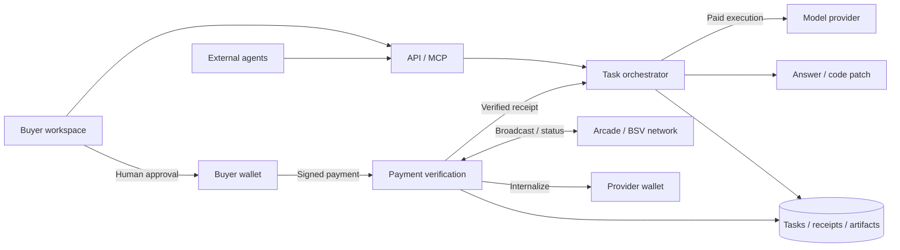

# mercaTUM

Buy a bounded AI chat or code task with BSV. A coordinator agent requests paid execution, the buyer approves a fixed quote in a standard wallet, and the server verifies payment before running the task.

[Live app](https://mercatum-ai.vercel.app) · [Project scope](docs/project-brief.md) · [Recorded evidence](docs/verification.md)

The marketplace has eight demo offers across six brands. Sellers and capacity are simulated; the configured Gemini API performs real planning and execution. Selecting a catalog model does not route work to that brand's API.

## Status

Recorded on 31 October 2026: frontend and persistent backend deployed; real Gemini planning, public repository import, MCP submission, reload/restart persistence and BSV Desktop connection observed. Real payment, Arcade acceptance, paid answers and model-generated code patches remain unverified. Qualification is incomplete. See [current status](.ai/STATUS.md).

## Run locally

Requires Node >=22 and npm.

```sh
npm ci
cp .env.example .env
# Configure .env locally before starting model or wallet services.
npm run build
npm start
```

Open [localhost:3000](http://localhost:3000). Preserve an existing `.env` instead of overwriting it. The server loads it at startup; restart after changes.

- Set `MODEL_PROVIDER`, `MODEL_ID` and `MODEL_API_KEY` for real model calls. The example config uses Gemini; startup checks tool-call support.
- Set `PROVIDER_WALLET_ROOT_KEY` for a separate operator-owned receiving wallet. Buyer keys stay in BSV Desktop or BSV Browser.
- Match `APP_NETWORK` to the buyer wallet. Local default: testnet; recorded deployment: mainnet.
- Keep `PAYMENTS_ENABLED=false` during setup. Follow [wallet validation](docs/deployment.md#payment-recovery-and-qualification) before live purchases.
- Persist `DATA_DIR`. Production also requires an HTTPS `PUBLIC_APP_URL` and a `SESSION_SECRET` of at least 32 characters.

Keep credentials in ignored local configuration or a server secret manager. Without model credentials, repository browsing and UI work; real planning and paid execution are unavailable.

## Use

1. Select a demo offer and submit a chat task. For code, import a public GitHub repository, pin its revision and approve the selected files as model context.
2. The coordinator calls `request_paid_execution`. Review the fixed quote: scope, execution limits, recipient, network, service sats and maximum debit including fees.
3. Approve the quote and authorize spending in the native wallet. The server checks the signed transaction, broadcasts through Arcade and records provider receipt before execution.
4. Read the answer or download changed files and `changes.patch`. Inspect the transaction through its WhatsOnChain receipt link.

Each question is a separate task; previous dialogue is not included automatically. Code tasks produce snapshot changes without running commands or pushing to GitHub; checks remain `not_run`. History is tied to the retained browser session.

For an uncertain payment, use **Check payment status** on the same attempt. Paid technical recovery keeps the original entitlement. Extra scope requires a new quote and approval. No prepaid balances or automatic refunds.

## Connect an agent

In **Connect your agent**, create a token and use the displayed `/mcp` Streamable HTTP endpoint with `Authorization: Bearer YOUR_TOKEN`. Tools: `list_providers`, `create_task`, `get_task`, `get_result`. Use a stable `requestId` for task creation. The token shares its browser owner's tasks; quote approval and native spending stay with the human. Tokens are shown once and can be revoked.

## Architecture



Buyer keys stay in the wallet. Paid execution requires a server-verified receipt; external agents cannot approve spending.

Vercel serves the React frontend and proxies API/SSE/MCP to one Node service. SQLite stores tasks, payment records and provider-wallet state on persistent disk. The server uses `@bsv/sdk` and `@bsv/wallet-toolbox` at sponsor-pinned versions.

[Architecture](docs/architecture.md) · [Contracts](docs/contracts.md) · [Payment flow](docs/bsv-flow.md) · [AI flow](docs/ai-flow.md) · [Deployment](docs/deployment.md)

## Verify and submit

```sh
npm run typecheck
npm test
npm run build
```

Tests use offline model/chain fixtures. They do not prove a live payment or paid result. For UI fixtures, run `npm run dev:client` and open `/test/fixtures/chat-preview.html?task=fixture` on the Vite port; the fixture is excluded from production.

The BSV track requires stack use, a standard wallet, a real transaction, non-custodial user funds and an agent payment. [Qualification gates](.ai/WORKFLOW.md#qualification-gates) define the evidence; [submission](docs/submission.md) lists delivery requirements. For changes, start with [AGENTS.md](AGENTS.md).
