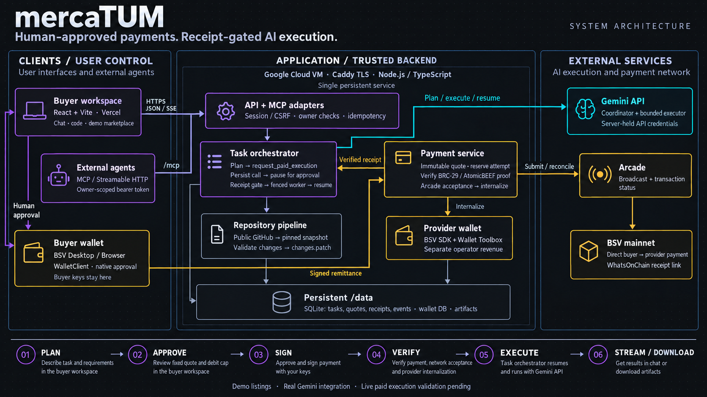

# mercaTUM

A buyer-side AI workspace for chat and focused public-repository code tasks. The rental listing and capacity dials are simulated. Model execution uses the configured server-side Gemini API (with the original Responses adapter retained); BSV payments use the buyer's standard wallet and a separate provider wallet.

**Live app: [mercatum-ai.vercel.app](https://mercatum-ai.vercel.app).** Vercel serves the frontend; a persistent HTTPS backend runs Gemini 3.8 Flash and a separate mainnet provider wallet. Real chat/code planning and MCP requests reach human approval; sessions and tasks survive a backend restart. Browser submission, reload, SSE and MCP through Vercel are verified. Safari WalletClient connects to BSV Desktop on mainnet. Quoting is enabled; exact purchase/native approval, real payment and paid results remain pending. See [observed evidence](docs/verification.md).

## System architecture



[Full-resolution PNG for presentations](docs/assets/mercatum-architecture.png) · [Architecture and trust boundaries](docs/architecture.md)

The server releases paid execution only after payment verification, Arcade network acceptance and provider-wallet internalization. Marketplace listings are simulated; live paid execution validation remains pending.

## Run locally

Node 22 or newer is required (verified on Node 24).

```sh
npm ci
npm run build
npm start
```

Open [localhost:3000](http://localhost:3000). The app binds to loopback outside production. Importing public repositories, reviewing files, the workspace and MCP token management work without a model key. Task planning requires a real configured model; no fake model output or payment-success route exists.

Copy `.env.example` to `.env` and configure it locally. Never paste keys into chat or commit them. `npm start` and `npm run dev` load `.env` when present; restart after changing it.

- `MODEL_PROVIDER`, `MODEL_API_KEY`, `MODEL_ID`: server-only provider selection and credentials. Deployment uses `gemini`, `gemini-3.8-flash`; `openai` retains the Responses adapter. Models must support tools, structured outputs and streaming. Startup performs a real tool-call/continuation capability probe; presence of a key alone does not enable purchases.
- `PROVIDER_WALLET_ROOT_KEY`: root key of a **separate operator-owned provider wallet**, never a buyer key. Keep its database under `DATA_DIR` backed up with its secret.
- `APP_NETWORK`: `testnet` by default; must match the buyer wallet.
- `TASK_PRICE_SATS`: fixed service price, default 100 sats, confirmed in each quote. This default is **not authorization to spend**.
- `SESSION_SECRET`: at least 32 random characters for production; `PUBLIC_APP_URL` must be the real HTTPS origin in production.
- `PAYMENTS_ENABLED=false`: retain until the chosen wallet's deployed-origin transport, unsigned draft/change metadata and human native spending behavior are verified. No spending is approved by this switch alone.

Buyer keys stay in BSV Desktop/BSV Browser. Review every quote's recipient, network, service price and maximum total debit. The adapter requests an unsigned draft, checks fee and wallet-owned change, then invokes native signing. A wallet that cannot supply the required draft reference/change metadata is blocked. Humans approve native spending; an automation must never click it.

## Checks

```sh
npm run typecheck
npm test
npm run build
```

Tests use offline chain/model dependencies only. They cover actual Toolbox wallets on a mock chain, proof/amount/script replay rejection, fee bounds, claim idempotency, ownership/CSRF, MCP protocol/auth, persistent worker recovery, bounded model continuation and validated patch artifacts. These tests do not establish a real on-chain transaction or live AI result.

## Using the workspace

1. Select Chat or Code. Code imports a public GitHub repository at an immutable commit; review files and explicitly approve context before sending it to the model.
2. Submit a bounded task. Operator-funded planning assesses scope and produces an actual `request_paid_execution` tool call.
3. Connect your wallet and review the immutable fixed quote. Approval reserves one payment attempt; the native wallet signs only after the draft fits the debit bound.
4. The server verifies the proof, submits the same transaction to Arcade, observes network acceptance and internalizes provider revenue before releasing paid execution.
5. Read the answer or download actual code changes and `changes.patch`. Code checks remain **not run**. No shell execution or automatic GitHub writes occur.

Unknown payments reconcile the same attempt; do not pay again. Technical recovery keeps the original entitlement. Known limit exhaustion preserves valid partial progress; additional scope is a separately approved task. There are no automatic refunds or prepaid balances. Browser history belongs to the retained secure session, not a cross-device account.

The nine original design references are preserved under [design prompts](docs/design-inputs.md). Activity displays real server events, never fabricated hidden reasoning or tool activity. The chat uses a question bubble, plain answer and persistent composer. Its expandable thinking trace disappears as answer text arrives. Enter sends; Shift+Enter adds a line. New questions are separate tasks and do not automatically include previous answers as context.

For offline UI checks, run `npm run dev:client` and open `/test/fixtures/chat-preview.html?task=fixture` on the Vite port. The labelled fixture controls exercise progress, streaming, approval, completion and failure without a model or payments; this harness is excluded from the production build.

## Agent access

Create a token in **Connect your agent**, then configure your MCP client with the displayed `/mcp` Streamable HTTP endpoint and `Authorization: Bearer YOUR_TOKEN`. Tokens are stored hashed, shown once and revocable. Four tools share browser ownership and task services: `list_providers`, `create_task`, `get_task`, `get_result`. Use a stable `requestId` for idempotent task submission. Approval stays in the browser/native wallet. Result artifacts can be returned to the authenticated MCP client.

Free planning admission is shared across browser/MCP: 10 tasks per owner/hour, 60 globally/hour and two active operations at once, plus HTTP IP limits. Production should add suitable account enrollment and edge controls before broad use.

## Deployment

`Dockerfile` builds one Node service; `compose.yaml` mounts durable `/data` and publishes only a loopback port. `docker compose up --build -d` requires `.env`, a production HTTPS origin and session secret. The deployed VM uses Caddy for HTTPS; Vercel proxies API/MCP requests to it. Run a single instance; do not use ephemeral serverless storage. The source pack remains untouched.

`/healthz` indicates process liveness; `/readyz` is 503 while paid service is unavailable. Both SQLite application and provider-wallet state must persist. See [deployment runbook](docs/deployment.md), [contracts](docs/contracts.md), [task ledger](.ai/TASKS.md) and [qualification evidence](docs/verification.md).
