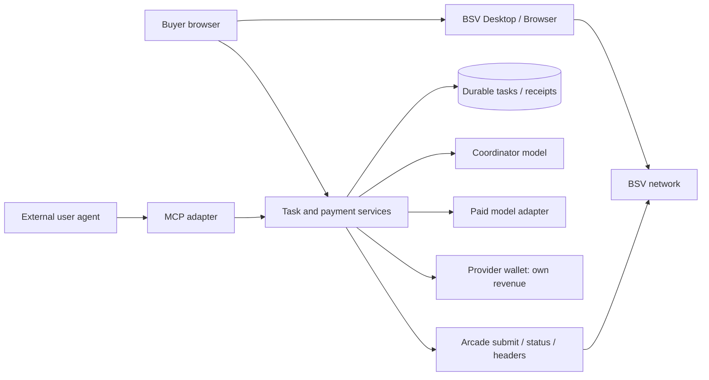

# Architecture

The local implementation uses one Node >=22 TypeScript service serving a built React/Vite frontend, JSON routes, SSE and remote MCP. Public deployment and live qualification remain pending. One process with persistent SQLite storage is sufficient for this demo and avoids distributed payment claims. Choose exact non-BSV dependencies during preflight and lock them; BSV versions come from the sponsor pack.

## Modules and authority

These implemented module paths are ownership boundaries for [tasks](../.ai/TASKS.md).

| Module | Owns | Cannot authorize |
|---|---|---|
| `src/shared/` | Runtime schemas, public DTOs and event types from contracts.md | Payment verification or server secrets |
| `src/client/wallet/` | WalletClient connection, quote approval, BRC-29 construction, remittance upload | Marking a task paid |
| `src/server/payments/` | Immutable quotes, attempt reservation, proof verification, Arcade, merchant receipt | Spending the buyer's funds |
| `src/server/tasks/` | Durable state, entitlement, worker claims, pending agent calls, sanitized events | A second debit on retry |
| `src/server/ai/` | Coordinator and executor using one configured API provider | Setting recipient, price or wallet permissions |
| `src/server/repos/` | Bounded public GitHub snapshot, approved context, validated changes and artifacts | Executing repository code or writing to GitHub |
| `src/server/mcp/` | Thin authenticated adapter over task services | Bypassing browser/wallet approval |
| `src/client/` | Chat/code shell, history, approval/result views from design inputs | Trusted payment/agent status derived from UI state |

The task worker survives a disconnected SSE client. Payment operations are serialized per attempt; execution claims use a database transaction. The provider wallet runs its own monitor. Browser state is a cache of the server ledger.

## What the chain secures

The transaction locks the merchant payment to a derived key controlled by the provider wallet. Consensus checks signatures, spend rules and double spends. The application verifies that this output matches one stored quote before releasing paid execution. BRC-29 gives fresh derived payment outputs without handing the platform buyer keys.

The quote-to-task binding, idempotency, session authorization and execution permission are application responsibilities. The chain does not evaluate answer quality or guarantee delivery after payment. This design uses direct payment rather than escrow; expose paid failure/recovery honestly. A future conditional-delivery protocol needs a separate contract and a defined dispute model.

## Privacy and trust boundaries

| Data | Location / protection | Limit |
|---|---|---|
| Buyer private keys | Standard wallet only | Frontend compromise can still request a malicious payment; native wallet permission and human review matter. |
| Provider root key and model key | Backend secret store; never client bundles, model context or logs | Operator controls its own received funds and API account. |
| Prompts, selected repository files, outputs | TLS in transit; private storage on an encrypted persistent volume; owner-authorized reads | Backend and model provider see submitted context. This is not end-to-end encryption against them. |
| Payment amounts, outputs, txids | Public BSV ledger | Fresh addresses reduce address reuse, not all linkability. Do not claim anonymous payments. |
| Quote, task binding and receipt | Private ledger and authenticated API | No prompt, repository contents or buyer identity document goes on chain. |
| Logs / judging evidence | Redacted IDs, state, timings, sats, txids and public links | Exclude headers/tokens, raw BEEF, derivation remittance, prompts and opaque model checkpoints. |

Serve a restrictive CSP, render model Markdown safely, validate Origin/CSRF on cookie-authenticated mutations, and authorize every task/event/artifact lookup by owner. Rate-limit free planning and paid task submissions. Repository text cannot change tool permissions or payment policy.

Optional later: a salted commitment to a result or receipt can anchor a timestamp without publishing content. It proves a committed byte sequence, not execution quality, and is unnecessary for qualification. Do not publish unsalted hashes of predictable private prompts.

## Deployment contract

- One public HTTPS origin, one Node instance, a private persistent volume under `DATA_DIR` for application DB, provider-wallet DB and artifacts. Ephemeral serverless storage is insufficient. No autoscaling until payment replay storage and worker leases are shared correctly.
- Configuration: `PUBLIC_APP_URL`, `APP_NETWORK` (`mainnet` or `testnet`), `DATA_DIR`, `TASK_PRICE_SATS`, `MODEL_ID`. Secrets: `MODEL_API_KEY`, `PROVIDER_WALLET_ROOT_KEY`, `SESSION_SECRET`. The buyer supplies none of these secrets.
- Derive Arcade, chaintracker and explorer settings from the trusted network mapping in bsv-flow.md. Reject wallet network mismatch before payment.
- `/healthz` reports process liveness; `/readyz` checks migrations, storage, merchant initialization and required configuration without leaking secrets. Verify model account access separately before charging; configuration presence alone is insufficient.
- Run the provider wallet monitor, graceful worker shutdown and restart reconciliation. Keep backups of wallet data as well as its root secret; verify paid-task recovery after a restart.
- Use configured hosting access when available. Prepare the deployable build first; if host/secrets are unavailable, record the exact blocker and finish independent checks. A local build is not a deployment.
